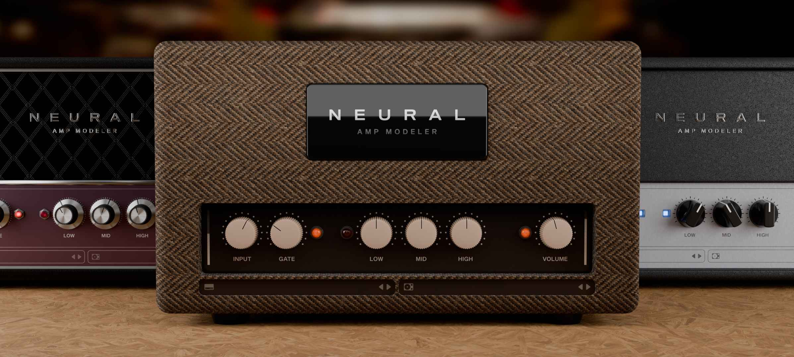

These are UI assets for different amplifiers. Feel free to use them in any project you want as long as you give credit.

This is licensed under [CC BY 4.0](https://creativecommons.org/licenses/by/4.0/legalcode.en)

To do:

- Knob 4 rendered wrong
- The other assets and their project files have to be uploaded
- Flat UI elements
- Higher fidelity renders
- Better file naming

The goal is to make a huge repo of GUI art assets across many different plugins and advocating for a standardised way of storing assets
that would allow a way for users to say "i want this knob file to be the knob used across every plugin i have"
you would essentially be able to theme all your plugins at once
